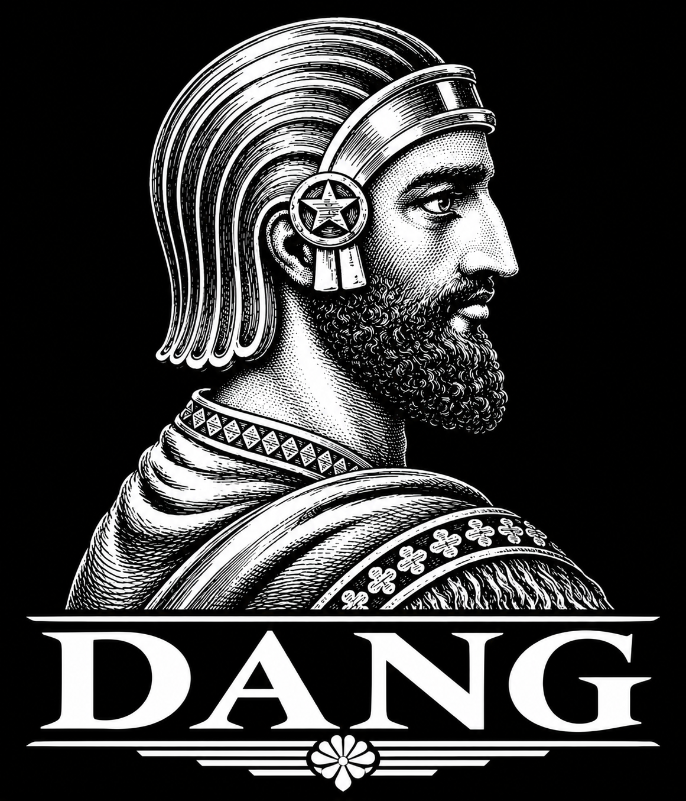
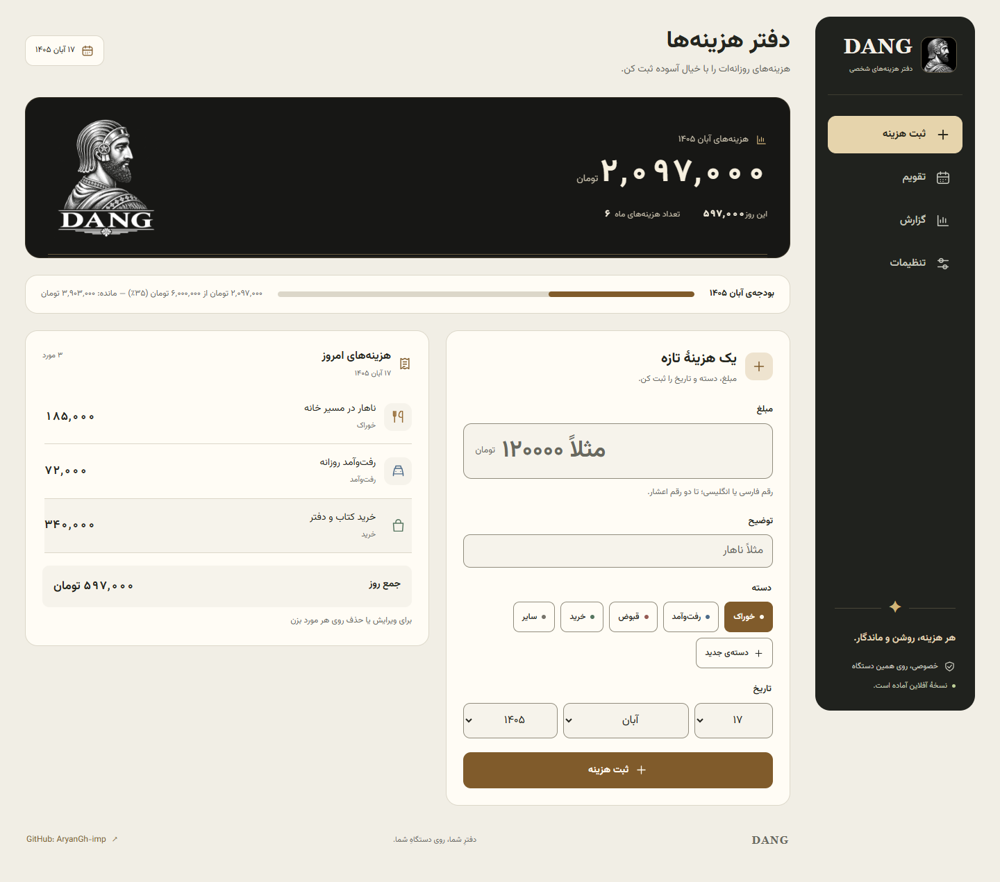
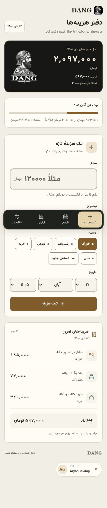

<p align="center">
  
</p>

# DANG — دفتر هزینه‌ها

**اولین نسخهٔ پروژه: 1.0.0** · تگ Git: `v1.0.0`

[English README](README.md) · سازنده: [AryanGh-imp](https://github.com/AryanGh-imp) · [مخزن DANG](https://github.com/AryanGh-imp/DANG)

برنامهٔ استاتیک برای هزینه‌های شخصی، با رابط فارسی/انگلیسی و تقویم شمسی/میلادی.

هویتی الهام‌گرفته از حکاکی، سنگ و فلز در هنر ایران باستان: نمای دسکتاپ با نوار کناری، ناوبری پایین صفحه در موبایل، فونت محلی وزیرمتن و شش تم روشن و تیره همراه با حالت خودکار. تصویر اصلی، آیکون مرورگر و آیکون نصب برنامه از نشان یکسان ساخته شده‌اند.



<p align="center">
  
</p>

## اجرا و انتشار

برای استفادهٔ محلی، فایل HTML را مستقیم باز نکنید؛ ماژول‌ها و قابلیت آفلاین به وب‌سرور نیاز دارند:

```sh
npm ci
npm run serve
```

سپس [نسخهٔ محلی](http://127.0.0.1:4173/Dang/) را باز کنید.

برای GitHub Pages در Settings → Pages گزینهٔ Source: GitHub Actions را انتخاب کنید. پس از بررسی نهایی و پوش شاخهٔ `main`، workflow تست‌ها را اجرا می‌کند و فقط خروجی `dist/` را منتشر می‌کند. مسیر هدف [سایت DANG](https://aryangh-imp.github.io/DANG/) است و پس از انتشار موفق فعال می‌شود. فایل‌های توسعه، مثال پشتیبان و اطلاعات Git وارد خروجی انتشار نمی‌شوند. همهٔ مسیرهای داخلی برنامه نسبی‌اند.

```sh
npm run check
npm run build:pages
npm run test:pages
```

راهنمای کامل [انتشار](docs/deployment.md)، [توسعه](docs/development.md)، [معماری](docs/architecture.md) و [فرمت پشتیبان](docs/data-format.md) به انگلیسی نوشته شده است.

```text
index.html                 رابط برنامه
app.js / store.js           رفتار و ذخیره‌سازی
i18n.js / themes.js         ترجمه‌ها و تم‌ها
icons.js                    نشانه‌های کنترلی رابط
sw.js / manifest.webmanifest
assets/
  branding/                 نشان اصلی و آیکون‌های مشتق‌شده
  css/styles.css            طراحی واکنش‌گرا
  fonts/                    وزیرمتن و مجوز OFL
docs/                       راهنمای طراحی و پیش‌نمایش‌ها
scripts/                    سرور محلی و تولید آیکون‌ها
tests/                      بررسی رفتار و دسترس‌پذیری
.nojekyll
```

تصویر ارسالی با نام `Ancient Warrior Engraving Emblem.png` بدون تغییر محتوای اصلی به `assets/branding/dang-emblem.png` منتقل شده است. نسخهٔ WebP برای نمایش سریع، آیکون‌های PNG برای مرورگر/iOS/Android، و تصویر اشتراک‌گذاری از همین فایل تولید شده‌اند. برای تولید دوباره، با Python و Pillow اسکریپت `scripts/build-brand.py` را اجرا کنید. راهنمای رنگ‌ها، دسترس‌پذیری و منابع در [سیستم طراحی](docs/design-system.md) آمده است.

## داده‌ها و آفلاین

- داده‌ها در IndexedDB همین مرورگر و مخصوص مسیر این برنامه ذخیره می‌شوند. تراکنش‌ها مانع بازنویسی آرایهٔ قدیمی از تب دیگر می‌شوند. ویرایش هم‌زمان یک هزینه پیام تعارض می‌دهد.
- در اولین اجرای نسخهٔ جدید، داده‌های `expenses-v1` و `expenses-settings-v1` از localStorage منتقل می‌شوند. اصل داده‌های قدیمی حذف نمی‌شود و نسخهٔ اصلی در تنظیمات قابل دانلود است. داده‌های نامعتبر برای نمایش پاک‌سازی می‌شوند و اصل آن‌ها برای بازیابی نگه داشته می‌شود.
- پس از نمایش «نسخهٔ آفلاین آماده است»، صفحه بدون اینترنت نیز باز می‌شود. Service Worker فقط فایل‌های همین پروژه را کش می‌کند؛ هیچ CDN یا درخواست شخص ثالث لازم نیست.
- هنگام انتشار تغییر جدید، مقدار `VERSION` در `sw.js` را افزایش دهید. نسخهٔ تازه باید همهٔ فایل‌هایش را کش کند تا نصب شود؛ سپس کش قبلی همین برنامه پاک می‌شود. داده‌های هزینه جدا از این کش هستند.
- ماندگاری دائمی تضمین‌شده نیست. حالت خصوصی، پاک‌کردن داده‌های سایت و سیاست مرورگر ممکن است داده را حذف کنند. دکمهٔ درخواست ماندگاری حافظه کمک می‌کند، ولی جای پشتیبان را نمی‌گیرد.
- برای انتقال به دستگاه، مرورگر یا دامنهٔ سفارشی دیگر، فایل JSON پشتیبان را دانلود و در مقصد بازیابی کنید. دادهٔ دامنه‌ها خودکار منتقل نمی‌شود.

## گزارش و پشتیبان

مبلغ مثبت با حداکثر دو رقم اعشار پذیرفته می‌شود؛ رقم‌های فارسی، عربی و انگلیسی و جداکننده‌های معتبر هزارگان پشتیبانی می‌شوند. واحد پول فقط برچسب است و مبلغ‌ها را تبدیل نمی‌کند.

میانگین روزانه بر تمام روزهای بازهٔ انتخاب‌شده محاسبه می‌شود؛ برای «همه»، از اولین تا آخرین تاریخ کل داده‌ها. بودجه و مقایسهٔ ماهانه همیشه کل ماه را پوشش می‌دهند و این موضوع در گزارش نوشته شده است.

بازیابی، موارد تازه را ادغام می‌کند و نسخهٔ متفاوت با شناسهٔ یکسان را جدا نگه می‌دارد. با گزینهٔ مربوطه، تنظیمات پشتیبان هم برمی‌گردند؛ دسته‌های مورد استفادهٔ هزینه‌های قبلی حفظ می‌شوند. پشتیبان نامعتبر بدون تغییر داده‌ها رد می‌شود.

خروجی PDF پیش‌نمایش چاپ مرورگر را باز می‌کند؛ در پنجرهٔ چاپ گزینهٔ Save as PDF را انتخاب کنید. متن قابل انتخاب است و سرستون‌ها روی صفحات تکرار می‌شوند. متن‌های شبیه فرمول در CSV به صورت متن خنثی می‌شوند.

## بررسی‌ها

```sh
npm test
npm run test:e2e
npx playwright install webkit
npx playwright test --config playwright.webkit.config.js
```

تست‌های مرورگر به Chrome نصب‌شده یا Chromium مخصوص Playwright نیاز دارند. برای نصب Chromium: `npx playwright install chromium`.

تست‌های طراحی اندازه‌های ۳۲۰ تا ۱۴۴۰ پیکسل، چیدمان افقی گوشی، فارسی/انگلیسی، اندازهٔ کنترل‌های لمسی، همهٔ تم‌ها با axe، پنجرهٔ ویرایش و تاریخچهٔ ناوبری را بررسی می‌کنند. WebKit برای بررسی سازگاری موتور Safari استفاده می‌شود؛ بررسی خودکار جای آزمون روی دستگاه واقعی را نمی‌گیرد. تصاویر README از داده‌های ساختگی در محیط تست مستقل تولید می‌شوند.

## مجوز و مشارکت

کد و مستندات پروژه با مجوز [MIT](LICENSE) منتشر می‌شوند. فونت وزیرمتن مجوز مستقل OFL دارد و استفادهٔ مجدد از نشان از مجوز نرم‌افزار جداست؛ جزئیات در [NOTICE](NOTICE) آمده است. راهنمای [مشارکت](CONTRIBUTING.md)، [حریم خصوصی](docs/privacy.md) و [گزارش مشکل امنیتی](SECURITY.md) به انگلیسی موجود است.
