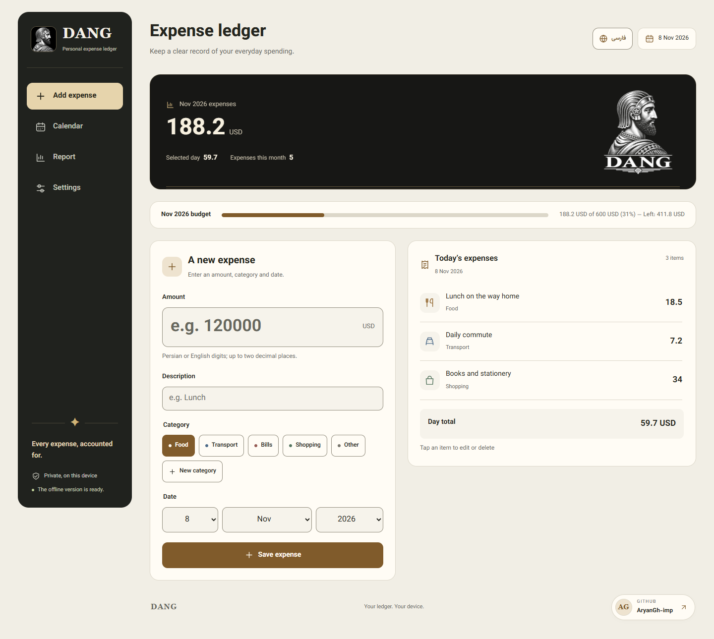
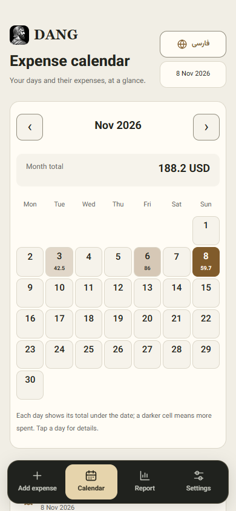

<p align="center">
  
</p>

# DANG — Personal Expense Ledger

**Current release: 1.0.1** · Git tag: `v1.0.1`

A private, offline-first expense tracker that runs entirely in your browser. DANG combines Persian and English interfaces, Jalali and Gregorian calendars, reliable local storage, and a visual identity inspired by ancient Persian engraving, stone, and bronze.

**English** · [فارسی](README.fa.md)

Created and maintained by [AryanGh-imp](https://github.com/AryanGh-imp). Repository: [AryanGh-imp/DANG](https://github.com/AryanGh-imp/DANG).

Use DANG at **[aryangh-imp.github.io/DANG/](https://aryangh-imp.github.io/DANG/)**. See the [release history](CHANGELOG.md) for maintenance improvements.

## Features

- Record, edit, and delete expenses with descriptions, dates, and customizable categories.
- Enter Persian, Arabic, or English digits, valid thousands separators, and up to two decimal places.
- Browse a calendar with daily totals and spending intensity.
- Filter reports by month or custom range, search descriptions and amounts, and track a monthly budget.
- Export JSON backups, spreadsheet-compatible CSV, and reports through the browser's Print / Save as PDF flow.
- Restore backups by merging expenses, preserving conflicting copies and optionally restoring settings.
- Work offline after the application has prepared its cache. No account or backend is required; optional Cloudflare Web Analytics does not participate in startup or offline caching.
- Use six coordinated light/dark themes or follow the device's appearance preference.
- Use a desktop sidebar or mobile bottom navigation, with RTL/LTR layouts, visible keyboard focus, and safe-area spacing.
- Start in your browser's first supported language (Persian or English), with English as the fallback. Switch at any time using the visible **English / فارسی** header button; your saved choice takes precedence on future visits.

New profiles pair Persian with the Jalali calendar and English with Gregorian. Changing the interface language keeps your selected calendar, expenses, and current expense draft.

Version 1.0.1 stabilizes the first render, serves smaller responsive branding images, and fixes English screen-reader descriptions and the GitHub link's accessible name. A small display-preference mirror helps show your saved language and theme immediately; IndexedDB remains the authoritative data store.

Currency choices are labels, not exchange-rate conversions. Expenses remain on the current browser, origin, and application path; devices do not synchronize automatically.

## Preview

Screenshots use an English interface, Gregorian dates and synthetic data in isolated test browsers. Phone previews capture a real 390 × 844 viewport, with navigation at the bottom.



<p align="center">
  
</p>

[Dark theme](docs/previews/en/imperial-dark.png) · [Report view](docs/previews/en/report.png) · [Mobile entry](docs/previews/en/mobile-entry.png)

## Run locally

Use Node.js 26 LTS, selected by `.nvmrc`. CI reads the same file, and `engines.node` requires Node.js 26 or newer. From the repository directory:

```sh
npm ci
npm run serve
```

Open [http://127.0.0.1:4173/Dang/](http://127.0.0.1:4173/Dang/). The development server also exposes `/DANG/` for exact GitHub Pages path testing. These paths intentionally have separate local databases.

Serve the application over HTTP on localhost or over HTTPS in production. Opening `index.html` directly with `file://` does not support its modules and service worker.

## Validate and prepare a release

```sh
npm run check
npm test
npx playwright install chromium webkit
npm run test:e2e
npm run test:webkit
npm run test:pages
```

On Linux, install browser system libraries with `npx playwright install --with-deps chromium webkit`. On Windows, the Chromium tests use installed Google Chrome when available; otherwise Playwright's Chromium is used. WebKit checks exercise Safari's engine, not physical iPhone hardware.

```sh
npm run build:pages
npm run serve:pages
```

The build copies an explicit set of application files into `dist/`; it does not bundle code. Development dependencies, Git metadata, documentation, screenshots, and example backups are excluded. No Node.js runtime or build process runs on the deployed website.

## GitHub Pages

The Pages workflow validates the application, runs Chromium and WebKit checks, tests the assembled release, and uploads only `dist/`. Deployment requires all checks to succeed.

For a new Pages setup, select **Settings → Pages → Build and deployment → Source: GitHub Actions**. A push to `main`, or a manual Pages workflow run on `main`, then deploys the site. See the [deployment guide](docs/deployment.md) for the release checklist, workflow permissions, production verification, update behavior, and rollback instructions.

## Updates

The app checks for new versions on startup, when returning online or to the page, and every five minutes while visible. Once the complete update is cached, an **Update app** button appears. Updating reloads the app while keeping saved expenses and settings. Unfinished input or an open editor postpones the reload; other tabs keep their drafts. Pages builds automatically fingerprint published files, so future feature changes receive a fresh cache without requiring a hard refresh.

## Data and privacy

IndexedDB stores expense data in atomic transactions and protects against stale writes from other tabs. Concurrent edits to the same expense report a conflict. Legacy localStorage data is migrated while retaining a recovery copy.

Browser storage is not a permanent backup. Private browsing, clearing site data, browser eviction, or changing the domain/path can make data unavailable. Download JSON backups regularly and import them when moving to another browser, device, or origin. The persistent-storage request in Settings can help reduce eviction, but browsers decide whether to grant it.

See [privacy and storage](docs/privacy.md), [backup format](docs/data-format.md), and [troubleshooting](docs/troubleshooting.md). Expense data and backups are not included in the release artifact.

While online, the site loads Cloudflare Web Analytics to measure visits and performance. The application does not send expenses, amounts, descriptions, category names, budgets or backups. Cloudflare receives page/performance and browser/device telemetry; internal view changes are tracked as visits to the same application path, with query parameters omitted by the current beacon. Blocking analytics leaves the ledger fully usable. See the [analytics disclosure](docs/privacy.md#cloudflare-web-analytics).

## Documentation

| Guide | Contents |
| --- | --- |
| [Architecture](docs/architecture.md) | Modules, transactions, cross-tab behavior, offline caching |
| [Development](docs/development.md) | Toolchain, commands, tests, repository structure |
| [Deployment](docs/deployment.md) | Pages setup, CI gates, release preparation, rollback |
| [Backup format](docs/data-format.md) | JSON fields, limits, validation, migration and merge rules |
| [Design system](docs/design-system.md) | Themes, typography, interaction patterns, accessibility references |
| [Privacy](docs/privacy.md) | Local data, hosting requests, backups and storage lifetime |
| [Troubleshooting](docs/troubleshooting.md) | Common storage, offline, export and deployment problems |
| [Contributing](CONTRIBUTING.md) | Contributions, reviews and verification |
| [Security](SECURITY.md) | Reporting security issues without exposing financial data |
| [Changelog](CHANGELOG.md) | Release history |

## License and credits

Application source and project documentation are [MIT licensed](LICENSE). The locally hosted Vazirmatn font uses the [SIL Open Font License](assets/fonts/OFL-Vazirmatn.txt).

The maintainer-supplied emblem is preserved as `assets/branding/dang-emblem.png`; responsive WebP images, small brand portraits, optimized PNG installation icons and the social image are generated by `scripts/build-brand.py`. Artwork reuse is separate from the software license. See [NOTICE](NOTICE) for attribution and licensing boundaries.
