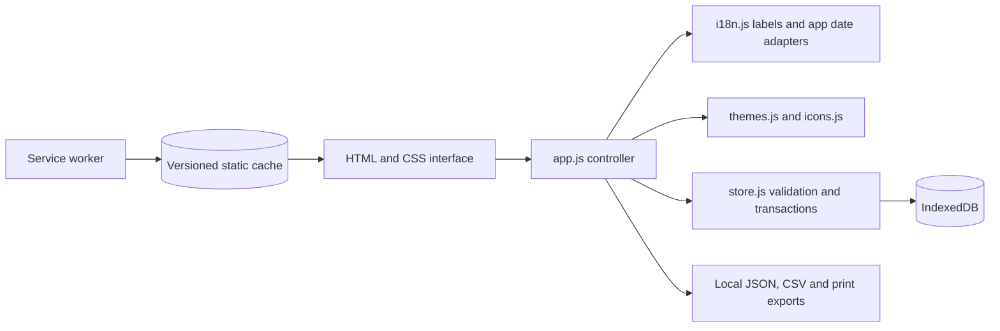

# Architecture

DANG is a static application built with HTML, CSS, and browser-native JavaScript modules. Production requires HTTPS static hosting, IndexedDB, and a service-worker-capable browser. Node.js and npm are development tools only.

## Module responsibilities

| File | Responsibility |
| --- | --- |
| `index.html` | Semantic application shell, navigation, forms, metadata, install links |
| `app.js` | View state, date adapters, rendering, user actions, reports, exports, focus and synchronization |
| `store.js` | Validation, normalizing legacy data, backup merges, IndexedDB transactions |
| `i18n.js` | Persian/English labels, calendar month names and weekday labels |
| `themes.js` | Theme definitions, system appearance selection, legacy aliases |
| `icons.js` | Inline SVG symbols for UI controls |
| `assets/css/styles.css` | Theme tokens, responsive layout, accessibility and printing |
| `sw.js` | Versioned, application-path-scoped static asset cache |
| `manifest.webmanifest` | Standalone installation identity, scope, launch URL, icons |

## Storage lifecycle

The database name is `dang-expenses-v3:` followed by the application directory path. The database has version 1 and an object store named `data`. Its `state` record contains `{ v, rev, settings, items }`; the optional `recovery` record retains original migration or repair data. The record format version, database version, package version, and service-worker cache version serve different purposes.

Every write reads the latest record inside an IndexedDB `readwrite` transaction, applies a synchronous operation, validates the result, increments the revision, and writes it back. IndexedDB serializes these transactions across tabs. Failed validation or writes abort the transaction; the UI does not report a successful save or clear its input on failure.

The application captures the expense being edited and compares it with the current stored expense before applying an edit. A conflicting edit reports a conflict rather than silently replacing the other tab's change. BroadcastChannel notifications, and synchronization when views become active, update local UI state. Transaction correctness does not rely on BroadcastChannel availability.

## Migration and recovery

At startup, the app reads the historical `expenses-v1` and `expenses-settings-v1` localStorage keys. The initial database record normalizes valid data and retains originals for recovery. Existing migrated records are not imported again on every launch. Invalid stored records can be repaired at startup while preserving the original record in recovery storage.

The browser's storage is scoped by origin as well as path. Changing from localhost to Pages, changing hostname, or changing application path creates a separate storage context. A JSON backup is the supported transfer mechanism.

## Views and navigation

The four views are entry, calendar, report, and settings. The `view` query parameter records the selected view (`add`, `calendar`, `report`, or `settings`). The History API supports back/forward navigation without separate routed HTML pages. Expense dates are stored as Gregorian ISO date strings; display adapters provide Jalali or Gregorian presentation.

Reports use integer cents for summation. Daily averages use all calendar days in the selected range, not only days with expenses. Monthly comparison and budget calculations use the whole month, independently of filtered report rows.

## Offline behavior

The worker derives its scope from its own URL and prefixes cache names with the application path. Installation precaches every listed asset and activates only after that set is cached. Fetch handling serves the installed version as a unit and ignores other projects' paths and external requests.

Activation removes previous caches belonging to the same app path and claims clients. Already loaded pages retain their JavaScript; a subsequent reload uses the newly installed version. Expense data lives separately in IndexedDB. Changes to runtime assets require a new `VERSION` in `sw.js`; see [deployment](deployment.md).

## Export boundary

JSON, CSV, and print reports are generated locally. Exported descriptions and custom currency labels are escaped before HTML rendering. CSV values resembling spreadsheet formulas are neutralized. PDF output uses native browser printing; it is not a separate PDF service or automatic cloud upload.
